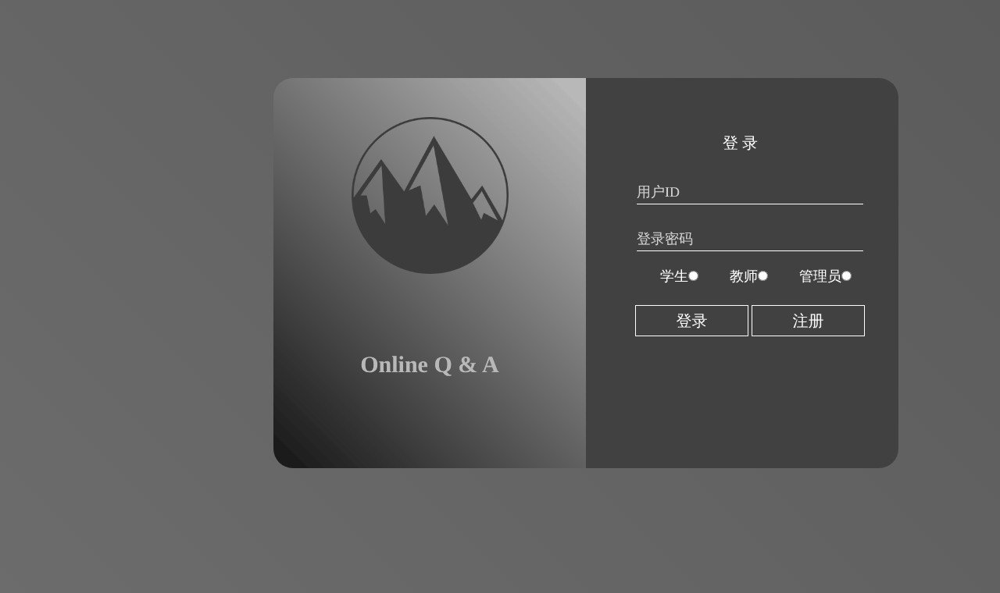
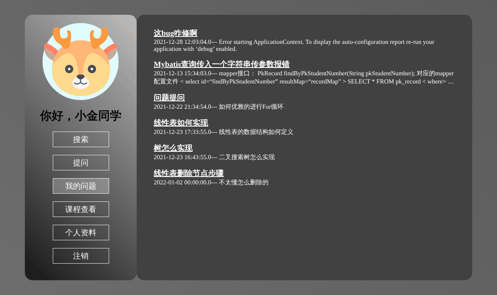
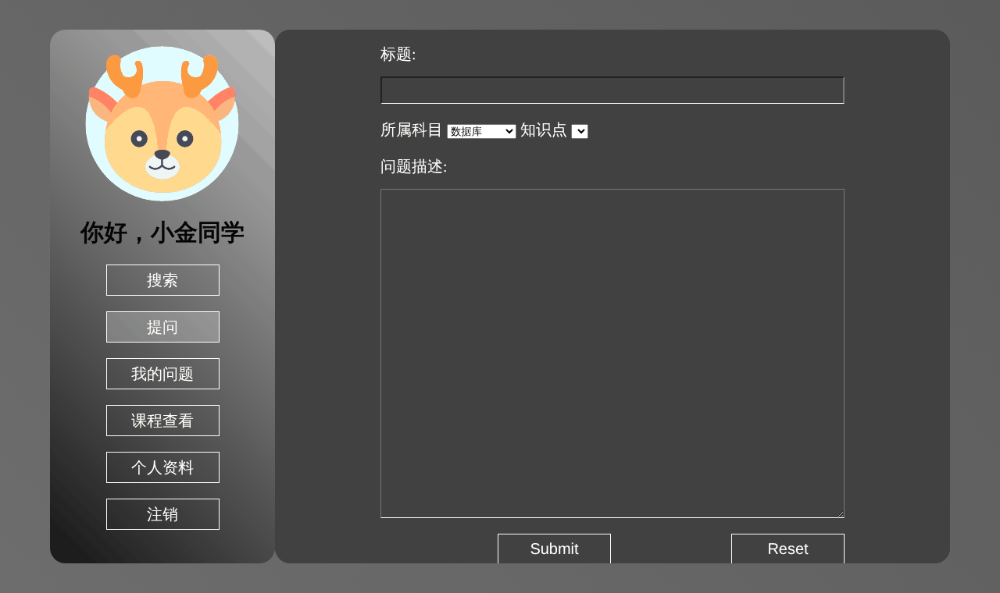
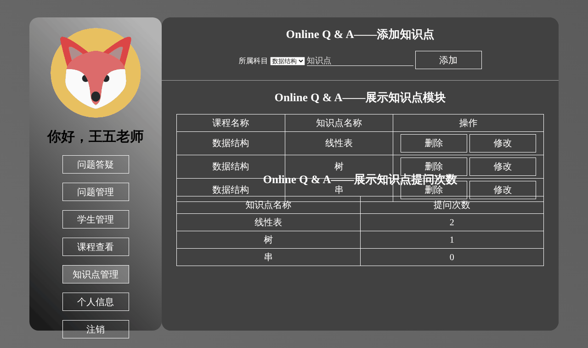
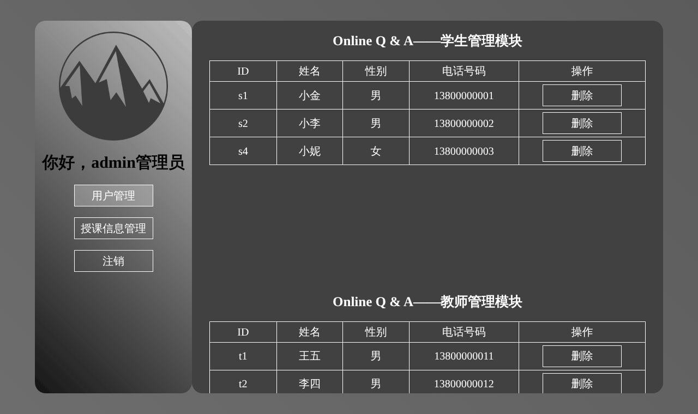

# 网上辅导答疑系统（Online Q & A）

学生在线提问、教师答疑的课程辅导网站，课程设计作业项目。
后端是 Spring + Spring MVC + MyBatis（SSM），页面用 JSP，数据库用 MySQL，用 Maven 打成 war 包后部署到 Tomcat。



| 学生：我的问题 | 学生：提问 |
| --- | --- |
|  |  |
| **教师：知识点管理** | **管理员：用户管理** |
|  |  |

## 功能

| 角色 | 功能 |
| --- | --- |
| 学生 | 注册、登录；按关键字搜索问题库；提问（选课程和知识点）；查看自己的问题和老师的回答；查看任课老师；查看和修改个人资料 |
| 教师 | 注册、登录；答疑（查看并回答学生问题）；问题管理（删除）；学生管理（把学生加入或移出自己名下）；课程查看；知识点管理（增删改，按知识点统计提问次数）；个人信息 |
| 管理员 | 学生和教师账号管理；课程和授课信息管理 |

## 技术栈

| 部分 | 用到的东西 |
| --- | --- |
| 后端 | Spring 4.0、Spring MVC、MyBatis 3.3（XML 配置，没有用 Spring Boot） |
| 页面 | JSP + JSTL，部分页面用 Bootstrap 3 和 jQuery |
| 数据库 | MySQL 5.7（驱动 mysql-connector-java 5.1.6） |
| 构建 | Maven，打包成 `target/Demo.war` |

## 运行

需要：JDK 8 或更高、Maven 3、MySQL 5.7（或 MariaDB）、Tomcat 9。
Tomcat 10 及以上不行，因为它们把 `javax.servlet` 换成了 `jakarta.servlet`。

2026-10 用 JDK 21 + MariaDB 10.11 + Tomcat 9.0.98 按下面的步骤实测过，上面的截图就是这样跑出来的。

1. 建库并导入表结构和示例数据：

   ```
   mysql -uroot -p -e "CREATE DATABASE answer_system DEFAULT CHARSET utf8mb4;"
   mysql -uroot -p answer_system < sql/answer_system.sql
   ```

2. 打开 `src/main/resources/db.properties`，把数据库账号密码改成你自己的（默认是 `root` / `root`）。

3. 打包：

   ```
   mvn package
   ```

4. 把 `target/Demo.war` 复制到 Tomcat 的 `webapps/` 目录。文件名就是访问路径，比如改名成 `answer.war`，启动 Tomcat 后打开 <http://localhost:8080/answer/>，会自动跳到登录页。

也可以用 IntelliJ IDEA 打开项目，配置一个本地 Tomcat 9，部署 `Demo:war exploded` 直接运行。

**MySQL 8 说明**：5.1.6 版驱动不支持 MySQL 8 默认的认证方式。可以改用 MySQL 5.7 或 MariaDB；也可以换成 `pom.xml` 里注释掉的 8.0.16 驱动，同时把 `db.properties` 里的 `jdbc.driver` 改成 `com.mysql.cj.jdbc.Driver`，并启用带 `serverTimezone` 的那行 URL。后一种方案没有实测过。

## 示例账号

导入 `sql/answer_system.sql` 后可以直接用：

| 角色 | 账号 | 密码 |
| --- | --- | --- |
| 学生 | `s1`（还有 `s2`、`s4`） | `123456` |
| 教师 | `t1`（还有 `t2`） | `123456` |
| 管理员 | `1` | `123` |

管理员用数字 ID `1` 登录，不是用户名 `admin`。示例数据里的手机号都是假号码。

## 目录结构

```
├── pom.xml
├── sql/answer_system.sql            建表语句和示例数据
├── docs/screenshots/                README 用的截图
└── src/main
    ├── java/AS/Demo
    │   ├── controller/              请求处理（登录、注册、提问、答疑、管理）
    │   ├── service/
    │   ├── dao/                     MyBatis Mapper 接口
    │   └── po/                      实体类
    ├── resources
    │   ├── db.properties            数据库连接
    │   ├── spring/                  spring-dao.xml、spring-mvc.xml
    │   └── mapper/                  MyBatis 的 SQL
    └── webapp
        ├── index.jsp                根路径跳转到登录页
        ├── jsp/                     各个页面
        ├── css/  js/  img/
        └── WEB-INF/web.xml
```

`webapp` 下的 `layui/`、`kindeditor/`、`html/`、根目录的 `index.html` 和 `jsp/index.jsp` 是模板自带的文件，现在的页面都没有用到。

## 已知问题

这是学习用的课程作业，**不要部署到公网**：

- 没有登录校验。页面靠 URL 参数区分用户，比如不登录直接访问 `/studentinfo.action?student_id=s2` 就能看到别人的资料，管理页面也一样。
- 密码明文存储、明文比对；注册表单用 GET 提交，密码会出现在地址栏里。
- 依赖版本很老（Spring 4.0.0 是 2013 年的版本，jackson-databind 2.5.0、mysql-connector-java 5.1.6 也一样），这些版本都有公开的安全漏洞。

## 课题要求（原 README）

设计一个网上辅导答疑管理系统，用户分为学生和教师。不同用户有不同权限，看到的功能也不同。

- 学生：注册与登录、问题库查询、学生提问
- 教师：注册与登录、人工答疑、问题管理、学生管理
- 主要数据表：
  - 教师基本信息表：教师 id、姓名、性别、职称、联系电话
  - 问答信息表：问题 id、问题标题、问题描述、提问人、提问时间、回答教师 id、回答时间、回答内容
  - 学生信息表（自建）

实际实现时用到的表：`student`、`teacher`、`admin`、`question`、`stu_tea`（师生关系）、`subject`、`sub_tea`（授课关系）、`knowledge`（知识点）。

## 第三方文件

仓库里带了几个前端库，它们各自的许可证见 [THIRD_PARTY_NOTICES.md](THIRD_PARTY_NOTICES.md)。
